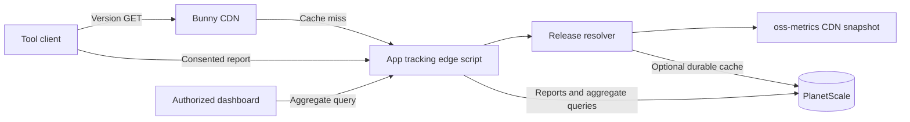

# RFC 0001: Service, API, and data model

- Status: Proposed
- Date: 2026-10-22
- Constraints: [ADR 0003](../adr/0003-independent-service-and-gradual-adoption.md),
  [ADR 0004](../adr/0004-independent-updates-and-opt-in-telemetry.md),
  [ADR 0006](../adr/0006-bunny-hosting-and-planetscale-storage.md)

## Outcome

I propose one small service with three responsibilities: version delivery,
durable ingestion of consented usage reports, and bounded aggregate queries.
The first implementation targets Bunny Edge Scripting with TypeScript and
PlanetScale Postgres. This is a new protocol; its `/v1/` namespace does not
inherit the old version-service wire version.

The service has one release resolver. Both version-only responses and optional
release information in report acknowledgements use it. No separately published
release manifest or second manually maintained version feed is required.

## Boundaries



The tool catalog is reviewed configuration: tool IDs, distribution packages,
release channels, supported commands, and allowed public release links. Request
fields must never become arbitrary upstream URLs. Adding a tool does not imply
enabling telemetry for its users.

The release resolver reads the existing CDN-cached oss-metrics snapshot.
oss-metrics owns GitHub release discovery; app-tracking owns release eligibility
and the version API. All installation methods share the GitHub release version,
with a minimum release age of one hour to reduce downstream publication races.
The host selects installation-aware upgrade instructions. No per-registry
readiness guarantee or fallback lookup is part of this contract.

Version-only requests use the public snapshot without querying private usage
analytics or PlanetScale. The snapshot also contains other public statistics;
a slow cold collection or unavailable snapshot can make a check advisory and
unavailable. Do not bypass that failure by introducing a duplicate release feed.
Preserve `generatedAt` as `checked_at` rather than renewing an old snapshot's
freshness. Exact age and retry bounds live in the maintained version contract.

## Proposed API

Production routes use HTTPS. The version and health routes are implemented in
the [version API contract](../version-api.md), with deployment described in the
[runbook](../deployment.md). The
remaining routes and telemetry schemas below are proposals. Examples omit real
credentials and use synthetic values.

| Method and path                                    | Contract                                                 | Cache           |
| -------------------------------------------------- | -------------------------------------------------------- | --------------- |
| `GET /v1/versions/{tool}/{distribution}/{channel}` | Read the latest eligible release                         | Public CDN      |
| `PUT /v1/installations/{id}`                       | Register a consented reporting installation idempotently | No store        |
| `POST /v1/usage-batches`                           | Accept an immutable usage batch                          | No store        |
| `DELETE /v1/installations/{id}`                    | Revoke reporting and delete its retained usage           | No store        |
| `GET /v1/admin/usage`                              | Read authorized aggregate results                        | No shared cache |
| `GET /health`                                      | Observe process liveness without ingesting usage         | No store        |

There is no legacy `/check` adapter. The public aggregate export for
`oss-metrics` is a later consumer contract, not an unrestricted view of the
private reporting tables.

### Version-only response

The maintained [version API](../version-api.md) owns the implemented response
schema, supported distributions, ETags, cache policy, upstream limits, and
errors. Its [synthetic fixture](../../test/fixtures/version.json) is exercised
through the real handler and the built deployment script.

The request contains no installed version, installation ID, repository hash, or
usage counter. The client compares versions locally. It owns installation-aware
update instructions; the service must not return an arbitrary shell command for
the client to execute. Automatic executable replacement is out of scope.

The initial implementation uses hourly freshness and a maximum retained-result
age of 24 hours, preserving `checked_at` during failures. It only retains last
successes within one service instance. The planned client interval adds its own
delay. The deployment probe verifies live CDN behavior; deterministic tests
cover cold/evicted-cache outages and stale-age boundaries.
A future authenticated refresh and durable cache remain separate changes.

### Reporting installation

After consent, the client generates a random installation UUID and a separate
256-bit random token, stores both locally, and uses the token as a Bearer
credential. The initial scope is one tool per local user profile; cross-tool
installation correlation remains an open decision. Repository identity is
shared across tools independently of that choice.

The registration body declares `tool_id` and `consent_revision`. The server
stores a hash of the high-entropy token, not the token itself. Repeating a
registration with the same identity, credential, and declaration succeeds.
An existing identity cannot be claimed with another credential or changed to
another tool. A revoked identity cannot be silently reactivated.

Registration is not proof of a real person, authentic software, or an actual
consent interaction. The server records the client's declaration; the client
must implement and test the consent flow. No shared secret embedded in a public
binary can establish trustworthy user counts.

### Usage batch

```json
{
  "schema_version": 1,
  "tool_id": "example-tool",
  "installation_id": "00000000-0000-4000-8000-000000000001",
  "batch_id": "00000000-0000-4000-8000-000000000002",
  "consent_revision": "telemetry-v1",
  "rows": [
    {
      "day": "2026-10-22",
      "tool_version": "1.2.3",
      "project_id": "aaaaaaaaaaaaaaaaaaaaaaaaaaaaaaaaaaaaaaaaaaaaaaaaaaaaaaaaaaaaaaaa",
      "project_id_version": 1,
      "command": "extract",
      "mode": "local",
      "count": 12
    }
  ]
}
```

The example project hash is synthetic. Project fields are omitted together
when no reliable project context exists. A row represents counts for one UTC
day and one combination of dimensions, not individual event timestamps.

Start with a proposed 64 KiB body limit and 256 rows per request. Validate the
actual streamed size, integer bounds, field lengths, UUID/hash shape, dates,
consent revision, and tool-specific command allowlists. Reject unknown fields
and duplicate dimensional rows within a batch. The limits require validation
against representative local queues before they become a stable contract.

The accepted batch identity is `(tool_id, installation_id, batch_id)`. Compute
the content hash from the validated, canonical payload; object-key order must
not turn an otherwise identical retry into a different report. A closed batch
never changes its ID or contents. Splitting an oversized local queue creates
distinct batches before any of them is submitted.

| Outcome                                               | Response and client behavior                       |
| ----------------------------------------------------- | -------------------------------------------------- |
| Committed or already committed with the same contents | `200`, with batch ID and `accepted` or `duplicate` |
| Invalid fields or an expired first submission         | `400`, fixed error code; do not retry unchanged    |
| Oversized body                                        | `413`; do not retry unchanged                      |
| Missing or wrong credential                           | `401`; do not register over an existing identity   |
| Revoked installation                                  | `410`; stop reporting                              |
| Existing batch ID with different contents             | `409`; preserve the conflict for local inspection  |
| Rate limited                                          | `429` with bounded `Retry-After`                   |
| Temporary database or service failure                 | `503`; retry the same batch with backoff           |

A dropped acknowledgement is an unknown outcome. Retry with the same batch ID;
never generate a fresh ID merely because the response was lost. Successful
ingestion may optionally include cached release metadata when requested. A
release lookup failure does not undo or hide a committed report.

## Proposed relational model

| Table                     | Key and significant fields                                                                                               | Role                                                         |
| ------------------------- | ------------------------------------------------------------------------------------------------------------------------ | ------------------------------------------------------------ |
| `release_versions`        | `(tool_id, distribution, channel)`; version, published/checked times, source status                                      | Rebuildable cache of the public oss-metrics release snapshot |
| `reporting_installations` | Installation UUID; immutable tool ID, token hash, consent revision, creation/last-seen/revocation times                  | Reporting authority and lifecycle                            |
| `telemetry_batches`       | Unique `(tool_id, installation_id, batch_id)`; canonical content hash, receipt time                                      | Durable duplicate detection                                  |
| `usage_counts`            | Batch key and row number; installation, tool, UTC day, optional project hash/version, command, tool version, mode, count | Attributable usage contributions                             |

Use foreign keys or equivalent database-enforced relationships to prevent a
batch or usage row from naming another tool's installation. Store project
hashes as 32 bytes and expose their lowercase hexadecimal representation on the
wire. Do not store repository names or raw URLs in a project table.

The write path takes an installation-row lock, verifies its credential,
consent revision, and active state, claims the batch identity, and inserts the
usage rows in one transaction. Concurrent deletion uses the same lock. A
duplicate with different contents cannot modify existing contributions.

A narrowly scoped database function is the initial proposal for this atomic
operation over the HTTP driver. Pass parameterized values; restrict execution
privileges and fix any privileged function's search path. Do not expose an
arbitrary SQL endpoint to clients. Validate actual database behavior before
relying on this design; HTTP transport is not itself an atomicity guarantee.

Begin with indexed queries on `(tool_id, day)`, installation IDs, and project
identity for the supported time windows. Query plans and measured workloads
determine further indexes or rollups. No queue, analytics warehouse, or
event-per-invocation storage is required initially.

## Deletion and derived data

Deletion authenticates the installation, revokes further writes, and removes
its retained usage and batch rows. The initial completion response is `204`
only after that database work commits. Repeated authenticated deletion remains
idempotent. A minimal revocation record can remain for a disclosed period to
prevent old retries or registration replays from recreating the identity.

Delete only this installation's contributions. Another installation reporting
the same project must retain its own data. Derived aggregates and caches need a
bounded invalidation or recomputation policy. Backup expiry, restore-time
deletion replay, and the revocation-record period must be settled in the
retention policy before production.

If deletion cannot complete within the tested request budget, define an
explicit asynchronous deletion contract and durable job state before shipping;
do not silently acknowledge unfinished work as complete.

## Aggregate contract

Initial private views cover invocations, active reporting installations, active
reporting projects, command distribution, and version adoption. Bound date
ranges and supported groupings; prohibit arbitrary SQL and free-form property
queries. Maintainer authentication and authorization are required before the
admin route is enabled. Reporting tokens grant no dashboard access.

Responses identify the measured unit, inclusive/exclusive UTC boundaries,
observation time, and coverage. A dependency failure is not a successful zero.
Public exports contain only approved aggregate dimensions, never installation
IDs, repository hashes, credentials, or row-level reports. Small-cell and
cross-query disclosure rules remain a production gate.

## Open decisions and proof

- Final route/schema naming, consent revisions, and identity scope/lifetime.
- Payload limits, retry/age windows, and retention from [RFC 0002](0002-client-consent-and-measurement.md).
- Maintainer authentication and aggregate disclosure policy; the implemented
  stale-version policy is maintained in the version API contract.
- Cold/warm latency, concurrent duplicate handling, deletion races, and query plans.
- Exact runtime and HTTP-driver compatibility from [RFC 0003](0003-deployment-and-migration.md).
