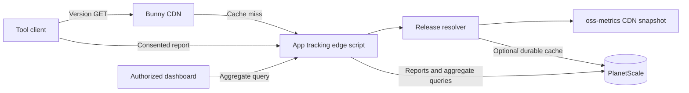

# RFC 0001: Service, API, and data model

- Status: Proposed
- Date: 2026-10-22
- Constraints: [ADR 0003](../adr/0003-independent-service-and-gradual-adoption.md),
  [ADR 0004](../adr/0004-independent-updates-and-opt-in-telemetry.md),
  [ADR 0006](../adr/0006-bunny-hosting-and-planetscale-storage.md)

## Outcome

I propose one small service with three responsibilities: version delivery,
durable ingestion of consented usage reports, and bounded aggregate queries.
The first implementation targets Bunny Edge Scripting with TypeScript and
PlanetScale Postgres. This is a new protocol; its `/v1/` namespace does not
inherit the old version-service wire version.

The service has one release resolver. Reports do not bundle version lookups in
v1; updates keep their independent read path. No separately published release
manifest or second manually maintained version feed is required.

## Boundaries

The tool catalog is reviewed configuration: tool IDs, distribution packages,
release channels, supported commands, and allowed public release links. Request
fields must never become arbitrary upstream URLs. Adding a tool does not imply
enabling telemetry for its users.

The release resolver reads the existing CDN-cached oss-metrics snapshot.
oss-metrics owns GitHub release discovery; app-tracking owns release eligibility
and the version API. All installation methods share the GitHub release version,
with a minimum release age of one hour to reduce downstream publication races.
The host selects installation-aware upgrade instructions. No per-registry
readiness guarantee or fallback lookup is part of this contract.

Version resolution uses the public snapshot without querying private usage
analytics or PlanetScale. Optional [service statistics](../service-statistics.md)
can increment a shared counter asynchronously; that write is independent of
release resolution and cannot block its response. The snapshot also contains other public statistics;
a slow cold collection or unavailable snapshot can make a check advisory and
unavailable. Do not bypass that failure by introducing a duplicate release feed.
Preserve `generatedAt` as `checked_at` rather than renewing an old snapshot's
freshness. Exact age and retry bounds live in the maintained version contract.

## Proposed API

Production routes use HTTPS. The version and health routes are implemented in
the [version API contract](../version-api.md), with deployment described in the
[runbook](../deployment.md). The
telemetry routes are specified in the maintained [telemetry API](../telemetry-api.md),
with consent and retention policies linked there. They are not implemented or
enabled by the contract. The aggregate routes below remain proposals.

| Method and path                                    | Contract                                                 | Cache           |
| -------------------------------------------------- | -------------------------------------------------------- | --------------- |
| `GET /v1/versions/{tool}/{distribution}/{channel}` | Read the latest eligible release                         | Public CDN      |
| `PUT /v1/installations/{id}`                       | Register a consented reporting installation idempotently | No store        |
| `POST /v1/usage-batches`                           | Accept an immutable usage batch                          | No store        |
| `DELETE /v1/installations/{id}`                    | Revoke reporting and delete its retained usage           | No store        |
| `GET /v1/admin/usage`                              | Read authorized aggregate results                        | No shared cache |
| `GET /health`                                      | Observe process liveness without ingesting usage         | No store        |

There is no legacy `/check` adapter. The public aggregate export for
`oss-metrics` is a later consumer contract, not an unrestricted view of the
private reporting tables.

### Version-only response

The maintained [version API](../version-api.md) owns the implemented response
schema, supported distributions, ETags, cache policy, upstream limits, and
errors. Its [synthetic fixture](../../test/fixtures/version.json) is exercised
through the real handler and the built deployment script.

The request contains no installed version, installation ID, repository hash, or
usage counter. The client compares versions locally. It owns installation-aware
update instructions; the service must not return an arbitrary shell command for
the client to execute. Automatic executable replacement is out of scope.

The initial implementation uses hourly freshness and a maximum retained-result
age of 24 hours, preserving `checked_at` during failures. It only retains last
successes within one service instance. The planned client interval adds its own
delay. The deployment probe verifies live CDN behavior; deterministic tests
cover cold/evicted-cache outages and stale-age boundaries.
A future authenticated refresh and durable cache remain separate changes.

### Telemetry authority and batches

The [telemetry API](../telemetry-api.md) owns registration, immutable batch and
acknowledgement schemas, canonical hashing, authentication, UTC/UUID age bounds,
limits, error/retry semantics, and deletion. Its JSON Schema and synthetic
vectors are the common input for server and Rust client implementation.
[Client consent](../telemetry-consent.md) owns effective configuration, per-tool
identity, CI scope, withdrawal/preview/reset, and bounded process lifetime.

Do not duplicate those rules in this RFC. The relational shape below remains a
candidate implementation of the agreed observable contract, not a second wire
specification or a proof of database transaction behavior.

## Proposed relational model

| Table                     | Key and significant fields                                                                                                                           | Role                                                         |
| ------------------------- | ---------------------------------------------------------------------------------------------------------------------------------------------------- | ------------------------------------------------------------ |
| `release_versions`        | `(tool_id, distribution, channel)`; version, published/checked times, source status                                                                  | Rebuildable cache of the public oss-metrics release snapshot |
| `reporting_installations` | Installation UUIDv7; immutable tool/context, token hash, consent declaration, last-new-batch and expiry/revocation times                             | Reporting authority and lifecycle                            |
| `telemetry_batches`       | Unique `(tool_id, installation_id, batch_id)`; canonical content hash, first receipt/expiry time                                                     | Durable duplicate detection                                  |
| `usage_counts`            | Batch key and row number; installation, tool, UTC day, optional project hash/version, command, tool version, count; mode inherited from installation | Attributable usage contributions                             |

Use foreign keys or equivalent database-enforced relationships to prevent a
batch or usage row from naming another tool's installation. Store project
hashes as 32 bytes and expose their lowercase hexadecimal representation on the
wire. Do not store repository names or raw URLs in a project table.

The write path takes an installation-row lock, verifies its credential,
consent revision, and active state, claims the batch identity, and inserts the
usage rows in one transaction. Concurrent deletion uses the same lock. A
duplicate with different contents cannot modify existing contributions.

A narrowly scoped database function is the initial proposal for this atomic
operation over the HTTP driver. Pass parameterized values; restrict execution
privileges and fix any privileged function's search path. Do not expose an
arbitrary SQL endpoint to clients. Validate actual database behavior before
relying on this design; HTTP transport is not itself an atomicity guarantee.

Begin with indexed queries on `(tool_id, day)`, installation IDs, and project
identity for the supported time windows. Query plans and measured workloads
determine further indexes or rollups. No queue, analytics warehouse, or
event-per-invocation storage is required initially.

## Deletion and derived data

The [retention policy](../telemetry-retention.md) owns visibility/cleanup,
receipts, finite tombstones, backups, provider recovery, and launch evidence.
The API owns synchronous authenticated deletion and its transaction ordering
against ingestion. Initial usage views are computed from nonexpired attributable
rows, with no durable rollups. Database/runtime and deletion proofs belong to
issues #6–#8; a timeout must not claim unfinished work is complete.

## Aggregate contract

Initial private views cover invocations, active reporting installations, active
reporting projects, command distribution, and version adoption. Bound date
ranges and supported groupings; prohibit arbitrary SQL and free-form property
queries. Maintainer authentication and authorization are required before the
admin route is enabled. Reporting tokens grant no dashboard access. The
implemented contract and separate enablement are in the
[maintainer reporting guide](../reporting.md) and
[ADR 0009](../adr/0009-private-maintainer-reporting.md).

Responses identify the measured unit, inclusive/exclusive UTC boundaries,
observation time, and coverage. A dependency failure is not a successful zero.
Public exports contain only approved aggregate dimensions, never installation
IDs, repository hashes, credentials, or row-level reports. Small-cell and
cross-query disclosure rules remain a production gate.

## Remaining implementation and proof

- Runtime/HTTP-driver and transaction proof from [RFC 0003](0003-deployment-and-migration.md).
- Concurrent duplicate/deletion races, bounded maintenance, and query plans.
- Actual processor/legal and operational enablement evidence from the retention policy and issue #11.
- Historical summaries and disclosure review in [RFC 0004](0004-historical-usage-summaries.md) / #13; public disclosure policy in #14.

Issue #5's wire, consent, identity-lifetime, retry, and retention choices are
specified in the maintained contract. Provider/runtime readiness is not inferred
from their specification or conformance fixtures.
